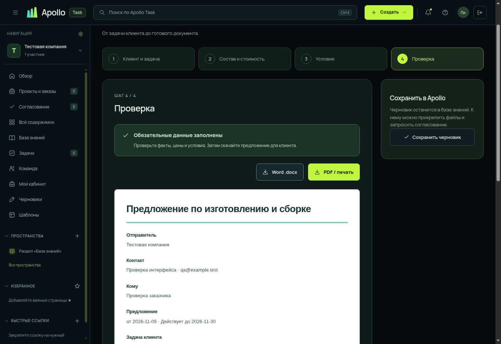

# Коммерческие предложения в Apollo Task

## Что изучено

Это качественный разбор открытых примеров, а не исследование распространённости инструментов по всему рынку.

- [МК СНГ-Экспорт — реальное КП в PDF](https://mksngexp.ru/uploads/files/cd/47/ea/ab/4a/dc/31/2c/84/a0/d5/ec/16/69/1f/a8/cd47eaab4adc312c84a0d5ec16691fa8.pdf): фирменная шапка и контакты, адресат, спецификация крепежа, количества, цены, налог, итог; сроки, доставка, этапы оплаты и срок действия. Ставки и цены из старого документа не переносятся в продукт.
- [TECHNIX — образец КП производителя промышленных комплектующих](https://msk.technix-rus.ru/baza-znaniy/obraztsy-dokumentov/obrazets-kp-kommercheskogo-predlozheniya/): состав поставки, цена, оплата, сроки, гарантии, срок действия и приложения. На странице доступен редактируемый образец DOCX.
- [СНХЗ — требования покупателя к КП, закупка 7244](https://snhz.ru/?event=zakupki&tr=zakupka&za=7244): прямо запрашиваются условия оплаты, сроки изготовления, гарантия, способ и пункт отгрузки; исходная спецификация приложена в XLSX. Закупка завершена — используется как пример требований.
- [АСП — предложение металлообработки](https://asp37.ru/upload/iblock/212/212f48d6c01c670c0e10423f3c3d12ca.pdf): общий материал о возможностях и обращение за индивидуальным расчётом по чертежам. Это другой сценарий, чем персональное предложение с согласованным составом и ценой.
- [HubSpot — Price Proposal](https://blog.hubspot.com/sales/price-proposal): предложение объясняет задачу и пользу решения, а не ограничивается прайсом. Внутренняя себестоимость отделяется от клиентской цены.
- [PandaDoc — quote templates](https://www.pandadoc.com/quote-templates/): веб-редактирование и выдача документа клиенту. [Документация экспорта](https://support.pandadoc.com/en/articles/15049034-download-documents-classic-experience) описывает PDF и Word и их ограничения.

Вывод для Apollo: один универсальный конструктор адресного КП для поставок, производства и услуг. Не привязывать его к конкретному изделию. Краткий документ с понятной ценой и условиями важнее декоративной презентации. Для сложных изделий технические материалы прикладываются отдельно.

## Вводимые данные и сценарий

1. **Клиент и задача.** Получатель, запрос или ТЗ, желаемый результат, решение. Реальные название компании и контакт сотрудника подставляются из пространства; их можно изменить. Никакие факты, кейсы и сертификаты не выдумываются.
2. **Состав и стоимость.** Наименование, характеристики, количество, единица, цена, скидка. Доставка и монтаж добавляются отдельными строками, если платные. Валюта RUB; до 100 строк. Один режим и ставка НДС для всего КП выбираются явно, без предположения о налоговом режиме компании.
3. **Условия.** Номер, дата, срок действия, оплата, срок и событие начала его отсчёта, доставка и следующий шаг. Дополнительно — границы работ, гарантия и приёмка, подтверждения компетенций, перечень приложений. Пустые необязательные разделы не попадают в документ.
4. **Проверка и экспорт.** Список недостающих данных ведёт к нужному полю. Незавершённый черновик можно сохранить; экспорт доступен после заполнения обязательных данных. Проверка полноты не заменяет проверку коммерческих и технических условий человеком.

## Реализация

- Структурированные данные КП хранятся у страницы в серверном рабочем пространстве. Повторное редактирование открывает конструктор. Снимки в истории включают структуру КП, её восстановление не теряет расчёт.
- КП можно связать с существующим проектом. Обсуждения, вложения и согласования используют существующую страницу документа.
- Денежные расчёты выполняются в целых копейках с BigInt. Количество до трёх знаков, цена и скидка до двух. Сначала округляется стоимость строки, затем скидка строки; налог рассчитывается от суммы строк. Итог не является расчётом себестоимости.
- Экспорт Word — настоящий редактируемый OOXML DOCX с таблицами. PDF — отдельный чистый макет A4 через штатное «Сохранить как PDF» в печати браузера. Экспорт не включает внутренние заметки, комментарии, себестоимость или панель сервиса.
- Избранные шаблоны сохраняются в личных серверных настройках сотрудника; отдельная вкладка и звезда на карточке. Доступно и наблюдателям, без изменения данных компании.
- Предыдущий шаблон расчёта переименован во «Внутренний расчёт стоимости» и остаётся отдельным инструментом.

## Границы текущей версии

Нет автоматического отправления клиенту, электронной подписи, AI-генерации фактов, импорта прайса из Excel, нескольких валют и смешанных ставок НДС в одном КП. Нет автоматического выбора действующей налоговой ставки. Перечень приложений — текст; реальные файлы прикрепляются к сохранённой странице.

Следующие обоснованные улучшения: каталог реальных товаров и услуг компании; повторное использование согласованных условий; импорт спецификаций с сопоставлением колонок и проверкой; варианты предложения; контроль версий, отправленных клиенту.

## Проверка

93 автоматических теста: расчёты, проверки обязательных полей, XSS-экранирование, структура Word, серверный цикл хранения КП и версий, изоляция личных шаблонов и прав. В браузере проверены каталог, звезда и вкладка избранного, четыре шага формы, добавление и удаление строк, пересчёт, подсказки, сохранение, повторное редактирование, восстановление версии, доступ наблюдателя, настольный экран и ширина 390 px. DOCX открыт встроенным Word-просмотрщиком; проверен печатный HTML-макет. Получение скачанного DOCX через облачный браузер не подтвердилось (ожидание события скачивания завершилось тайм-аутом); генерация файла и его отображение проверены отдельно. Нативная печать в PDF в этой среде не проверялась.

